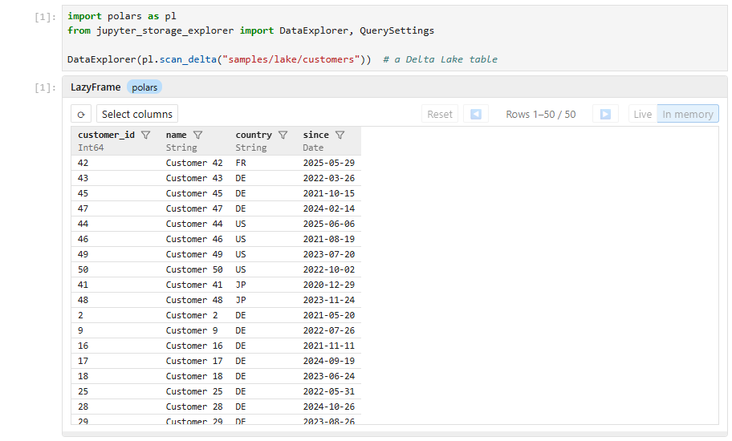

# Jupyter Storage Explorer

A file explorer for cloud storage and data lakes, right inside your Jupyter notebook, in the spirit of Azure Storage
Explorer.

Browse Amazon S3, Azure Data Lake / Blob Storage, Google Cloud Storage, local disks and more; preview Parquet files,
Delta Lake tables, CSV, Excel, JSON and other formats; page through, sort and filter tables; get ready-to-run code that
loads the data into your notebook; and upload, download, move and edit files without leaving JupyterLab.

Two widgets:

- **`StorageExplorer`**: the file explorer, with previews and the data browser.
- **`DataExplorer`**: the data browser alone, for one table.


## Installation

```bash
pip install jupyter-storage-explorer
```

Install the package for your storage too:

| Storage                        | Package    | Address                                              |
|--------------------------------|------------|------------------------------------------------------|
| Amazon S3                      | `s3fs`     | `s3://bucket/path`                                   |
| Azure Data Lake / Blob Storage | `adlfs`    | `abfs://container@account.dfs.core.windows.net/path` |
| Google Cloud Storage           | `gcsfs`    | `gs://bucket/path`                                   |
| Local disk, in-memory          | (included) | `/path`, `memory://`                                 |

Previewing and querying data files needs a data library, e.g. `pip install polars deltalake`. If one is missing, the
preview tells you what to install.

## Quick start

```python
from jupyter_storage_explorer import StorageExplorer

StorageExplorer("s3://my-bucket/data")
```

The explorer appears as the cell's output. Other examples:

```python
StorageExplorer()  # the current folder
StorageExplorer("abfs://lake@myaccount.dfs.core.windows.net/raw")  # Azure Data Lake
StorageExplorer("s3://my-bucket/data", profile="analytics")  # Amazon S3, with options
StorageExplorer("gs://my-bucket", token="google_default")  # Google Cloud
```

Options after the address (like `profile` above) are passed to the storage package, for example to choose credentials.

To open one table directly, see [DataExplorer](#dataexplorer-one-table). The `notebooks` folder has a demo of each
widget (`storage_explorer.ipynb`, `data_explorer.ipynb`) on sample data made by `make_samples.py`.

### From the JupyterLab launcher

The separate package **`jupyter-storage-explorer-launcher`** adds **Storage Explorer** to JupyterLab's launcher and
command palette, opening the explorer in its own tab on the launcher's folder (the one the file browser showed):

```bash
pip install jupyter-storage-explorer-launcher
```

What the tab shows can be configured with a `launcher.py` file; see the [launcher's README](launcher/README.md).

### Several storages in one explorer

Give each storage a name; a drop-down on the left of the address bar switches between them, and each one remembers the
folder you were in.

```python
StorageExplorer(
    filesystems={
        "Data lake": "abfs://lake@myaccount.dfs.core.windows.net",
        "Raw files (S3)": "s3://my-bucket/raw",
        "Local": "/home/me/data",
    },
)
```

## Using the explorer

**Browse**

- Click a folder in the tree on the left to list it; double-click a folder in the list to open it.
- Click a folder name in the address bar at the top to go back to it; ↑ goes to the parent folder and ⟳ refreshes.
- Click to select, Ctrl+click (⌘+click on a Mac) to select several items; click a column header to sort.

**Preview**

- Double-click a file to preview it in a panel below the list. While the panel is open, clicking another file previews
  that one. Esc or ✕ closes it.
- **Preview** in the toolbar previews the selected item, or, with nothing selected, the folder you are in — for example
  a Delta Lake table you opened from the tree. The button shows the format it will use, like *Preview (Delta Lake
  table)*.
- Tables (Delta Lake, Parquet, CSV, JSON Lines, Excel) open in the data browser instead when polars is installed: the
  button reads *Query data (…)*. See [Query data](#query-data).
- Drag the bar above the panel to share the space between the list and the preview; drag the bar at the bottom to make
  the whole explorer taller or shorter (not with `height="fill"`, where it follows its container).

**Right-click menu**

- **Preview** (or **Query data**) / **Preview as ▸**: show a file in another way, e.g. a JSON file as text.
- **Open**: open a folder.
- **Edit**: edit a text file, then **Save** or **Cancel**.
- **Python code ▸ Load with polars / pandas / …**: the code to load the data into your notebook, with the install
  command if a package is missing. Copy it into a cell.
- **Download**: save the selected files to your computer.
- **Copy URL**: copy the location of the selected items. Azure locations name the account, e.g.
  `abfs://container@myaccount.dfs.core.windows.net/raw/orders.csv`.

**Drag and drop**

- **Upload**: drop files from JupyterLab's file browser or from your computer onto the list (into the folder shown) or
  onto a folder.
- **Move**: drag files in the list onto a folder in the list or the tree.
- You are asked to confirm, and asked what to do if files with the same names already exist (**Overwrite**, **Skip
  existing** or **Cancel**).

## Query data

With [polars](https://pola.rs) installed (plus `deltalake` for Delta Lake tables and `fastexcel` for Excel), tables open
in a data browser rather than a fixed preview of the first rows. Rows are read 1,000 at a time as you page, not the whole
table (except Excel files, which are read whole).

- **Page** through the rows with ◀ and ▶, 100 rows at a time.
- **Sort**: click a column name; click again for descending, a third time to stop sorting.
- **Filter**: click the funnel next to a column name. Every column has *Null / empty*; numbers, dates and times have
  *Range* (from and to, both included; leave one empty for no limit); text has *Contains*, *Regex* and *Range*, each
  optionally ignoring case; true/false columns have *=*.
- Active filters are listed next to **Select columns**; click one to change it, or × to remove it.
- **Select columns** hides and shows columns.
- **Resize** a column by dragging the right edge of its header; double-click the edge to go back to automatic widths.
- **Reset** removes all filters and shows all columns again (sorting and widths are kept).
- **⟳** reads the data again, e.g. after it changed on the storage; filters, sorting and the page are kept.

polars reads the data itself from its location (the URL shown by **Copy URL**), with the credentials it finds in the
environment, not with the options given to the explorer. Tables on storage polars cannot read, such as `memory://`,
show an error instead of the data.

Filters, sorting, hidden columns and widths are remembered per table, so reopening it shows it as you left it. By
default they are remembered until the kernel restarts; to keep them for good, store them in a file:

```python
from jupyter_storage_explorer.query import QuerySettingsStore

settings = QuerySettingsStore("query-settings.json")
StorageExplorer("s3://my-bucket/data", query_settings=settings)
```

### DataExplorer: one table

`DataExplorer` opens the same data browser for a single table, without the file explorer around it:

```python
from jupyter_storage_explorer import DataExplorer

DataExplorer("s3://my-bucket/lake/sales")  # a Delta Lake table, Parquet, CSV, JSON Lines or Excel
DataExplorer("data/orders.tsv", format="CSV")  # choose the format by name
DataExplorer("abfs://lake@myaccount.dfs.core.windows.net/raw/orders.parquet", height="600px")
```



Options after the address are passed to the storage package, as for `StorageExplorer`; `query_settings=` works the same
way. If polars (or a package the format needs, such as `deltalake`) is not installed, `DataExplorer` raises an error
with the `%pip install` command instead of opening. Settings are shared with the explorer's Query data, so a table
looks the same in both.

## Supported formats

| Format                                                       | Preview                       | Query data | Load with               |
|--------------------------------------------------------------|-------------------------------|------------|-------------------------|
| Delta Lake tables                                            | First rows                    | ✓          | polars (with deltalake) |
| Parquet files, and folders of them (e.g. Spark, Hive output) | First rows                    | ✓          | polars, pandas          |
| CSV, TSV                                                     | First rows                    | ✓          | polars, pandas          |
| JSON Lines                                                   | First records                 | ✓          | polars, pandas          |
| JSON                                                         | Collapsible tree              |            | Python, polars, pandas  |
| Excel (`.xlsx`)                                              | First rows of the first sheet | ✓          | polars, pandas          |
| Markdown                                                     | Rendered                      |            | Python                  |
| Text, code, configuration (YAML, SQL, Python, …)             | With syntax highlighting      |            | Python                  |
| Images (PNG, JPEG, GIF, SVG, …)                              | Shown                         |            | Pillow                  |

## Working with the explorer from Python

```python
explorer = StorageExplorer("s3://my-bucket/data")
explorer
```

```python
explorer.folder_url  # the URL of the folder shown, e.g. to pass to polars or pandas
explorer.selected_urls  # the URLs of the selected items
```

## Options

| Option                              | Meaning                                                                                                                               |
|-------------------------------------|---------------------------------------------------------------------------------------------------------------------------------------|
| `height="400px"`                    | Height of the tree and list; the preview panel adds its own space below. `"fill"`: as tall as the container, e.g. the launcher's tab. |
| `max_upload_bytes=10 * 1024 * 1024` | Largest file you can upload from your computer (default 10 MB; `None` for no limit).                                                  |
| `filesystems={...}`                 | Several named storages, as shown above.                                                                                               |
| `query_settings=...`                | Where the data browser keeps its settings; see [Query data](#query-data).                                                             |

## Requirements

- Python 3.11 or later
- JupyterLab 4. The widgets also show in other Jupyter frontends, but dragging files from JupyterLab's file browser
  works only in JupyterLab.
- For Query data and `DataExplorer`: a recent polars (tested with polars 2.0).

## Development

Building from source, the JupyterLab extension, releasing, and customizing the explorer's icons with CSS:
see [DEVELOPMENT.md](DEVELOPMENT.md).
