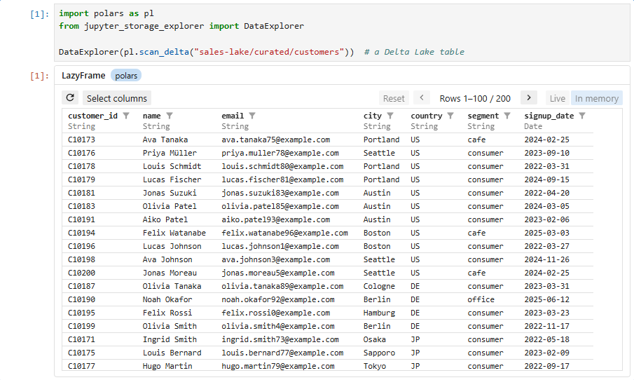
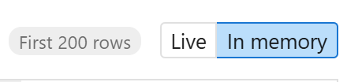
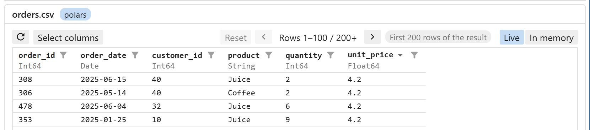
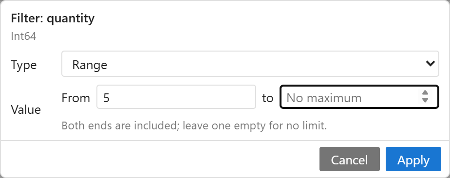
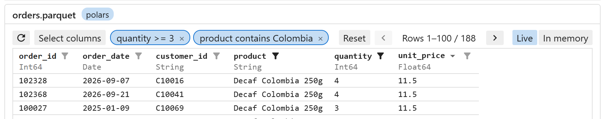
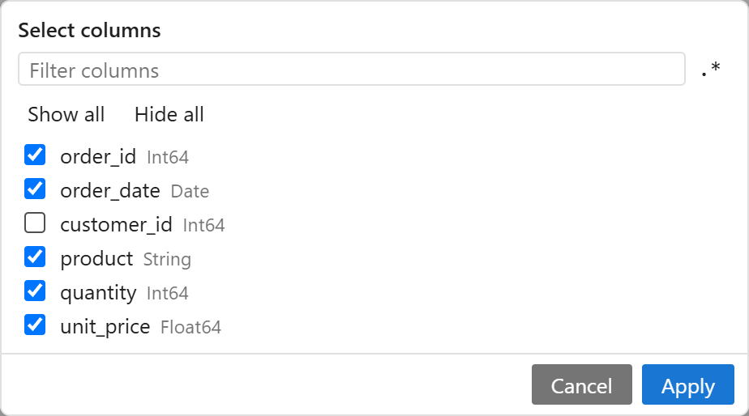

# DataExplorer

`DataExplorer` opens the data browser for a dataframe: pandas, polars, PyArrow, DuckDB, Spark, and the other libraries
[narwhals](https://narwhals-dev.github.io/narwhals/) supports. It is the browser `StorageExplorer` opens for tables.



- [Opening data](#opening-data)
    - [Live and in memory](#live-and-in-memory)
- [Using the data browser](#using-the-data-browser)
- [The result in code](#the-result-in-code)
- [Following the widget: on_change](#following-the-widget-on_change)
- [Settings in code: QuerySettings](#settings-in-code-querysettings)
- [DataExplorer options](#dataexplorer-options)
    - [Reading pages](#reading-pages)

## Opening data

```python
import polars as pl
from jupyter_storage_explorer import DataExplorer, QuerySettings

DataExplorer(pl.scan_parquet("s3://my-bucket/lake/sales/*.parquet"))
DataExplorer(spark.table("sales"), mode="memory")  # read the first rows into memory
DataExplorer(orders_df, settings=QuerySettings(sort="date", descending=True))
```

Pass a function (`lambda: pl.scan_parquet(url)`) for **⟳** to read the data again.

### Live and in memory

The data browser runs queries in one of two modes:

- **Live**: each page is a query on the data itself. Only the rows shown are read, so a table of terabytes opens as
  quickly as a small one.
- **In memory**: the first 100,000 rows are read into the kernel once. Filters and sorting then apply to those rows
  only.

Lazy dataframes open in live mode, e.g. Spark DataFrames, polars LazyFrames and DuckDB relations. Eager ones, such as
pandas', are always in memory.

We highly recommend live mode, whatever the data's size: pass `spark.table("sales")`, not
`spark.table("sales").toPandas()`.

Switch modes at the top right of the browser, or start in one with `mode=`.



## Using the data browser

### Page and sort

◀ ▶ to page. Click a column name to sort (again for descending, a third time to stop). **⟳** reloads the data.



### Filter

Click a column's funnel to filter it: *Null / empty* or *Range*, also *Contains* or *Regex* for text, and *=* for
true or false.



Active filters are listed in the toolbar: click one to edit it, × to remove it. **Reset** removes them all and shows
the hidden columns again.



### Select columns

**Select columns** hides and shows columns. Drag a header's edge to resize a column (double-click for automatic
widths).



## The result in code

`explorer.result()` gives the data with the widget's filters, sort order and hidden columns applied, as a dataframe of
the same library (lazy data stays lazy), all of it even **In memory**; `result(all_columns=True)` keeps the hidden
columns:

```python
explorer = DataExplorer(pl.scan_parquet("sales/*.parquet"))
# ... filter and sort in the widget ...
explorer.result().group_by("region").agg(pl.col("amount").sum()).collect()
```

## Following the widget: on_change

`explorer.on_change(function)` calls `function(explorer)` whenever `result()` changes in the widget, e.g. to redraw a
chart; `on_change(function, remove=True)` stops it. Draw into an `ipywidgets.Output` shown in a cell, and keep it
quick: the widget waits for it.

```python
import ipywidgets
import matplotlib.pyplot as plt

chart = ipywidgets.Output()


def draw(explorer):
    df = explorer.result(all_columns=True).group_by("region").agg(pl.col("amount").sum()).collect()
    with chart:
        chart.clear_output(wait=True)
        plt.bar(df["region"], df["amount"])
        plt.show()


explorer.on_change(draw)
draw(explorer)
chart  # in another cell
```

## Settings in code: QuerySettings

`settings=` sets the filters, sort order, hidden columns and widths to start with: a `QuerySettings`, or a dict or
JSON text. To keep settings made in the widget, print them and paste them into your code:

```python
explorer = DataExplorer(orders_df)
print(explorer.settings.to_json())  # after filtering and sorting in the widget

settings = """
{
    "filters": {"price": {"op": "range", "min": "10", "max": ""}},
    "sort": {"column": "date", "descending": true},
    "hidden": ["comment"],
    "widths": {}
}
"""
DataExplorer(orders_df, settings=settings)
```

## DataExplorer options

| Option                     | Meaning                                                                                                         |
|----------------------------|-----------------------------------------------------------------------------------------------------------------|
| `settings=QuerySettings()` | Filters, sort order, hidden columns and widths to start with: a `QuerySettings`, dict or JSON text (see above). |
| `mode="auto"`              | Where queries run first: `"auto"`, `"live"` (lazy data only) or `"memory"`; switch in the widget.               |
| `max_live_rows=5000`       | Data up to this size is kept in memory.                                                                         |
| `max_memory_rows=100_000`  | The most rows read into memory; also the most rows a live query gives.                                          |
| `fetch_rows=...`           | How pages are read; see [Reading pages](#reading-pages).                                                        |
| `title=...`                | Shown above the table (default: the dataframe's type).                                                          |
| `height="400px"`           | Height of the table area. `"fill"`: as tall as the container, e.g. a tab (not a notebook cell).                 |

### Reading pages

`fetch_rows=` customizes how rows of lazy data are read: the first rows when it opens, and each page of live queries,
e.g. with Spark's `offset()`:

```python
import narwhals as nw
from jupyter_storage_explorer import DataExplorer


def spark_offset(lf, offset, length):
    return nw.from_native(lf.to_native().offset(offset).limit(length)).collect()


DataExplorer(spark.table("sales"), fetch_rows=spark_offset)
```

Return `None` to read a page the default way. `StorageExplorer` takes the same `fetch_rows=` for its data browser
([Reading pages](storage-explorer.md#reading-pages)).
