# StorageExplorer

`StorageExplorer` is the file explorer: browse storage, preview files, query tables, and upload, download, move and
edit files.

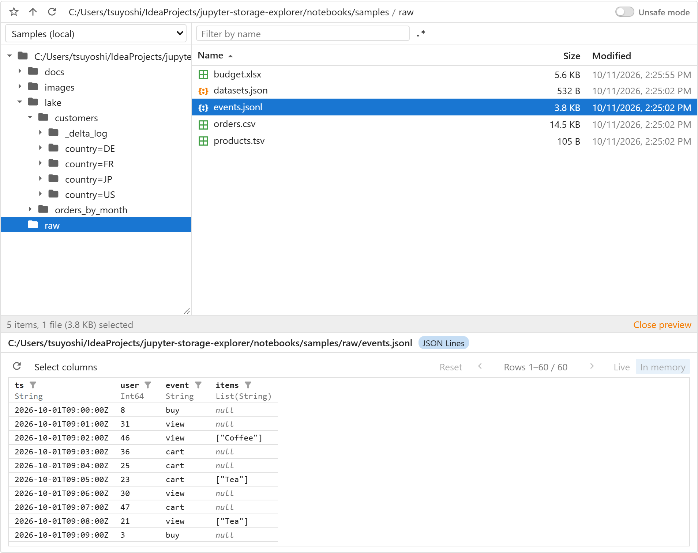

- [Installation](#installation)
- [Storages](#storages)
- [Using the explorer](#using-the-explorer)
- [Unsafe operations](#unsafe-operations)
- [Transfer policy](#transfer-policy)
- [Data browser and view tabs](#data-browser-and-view-tabs)
- [Remembered states](#remembered-states)
- [Supported formats](#supported-formats)
- [Format options](#format-options)
- [Working with the explorer from Python](#working-with-the-explorer-from-python)
- [StorageExplorer options](#storageexplorer-options)
- [Extensions](#extensions)

## Installation

```bash
pip install "jupyter-storage-explorer[polars]"
```

Engines and storages come as plugins, installed with extras of two kinds:

- **Full extras**, e.g. `[polars]`: the plugin and the libraries it uses (Polars, deltalake, fastexcel).
- **Support-only extras**, e.g. `[polars-support]`: the plugin alone, using the libraries already installed. Nothing
  else is installed or upgraded.

| Full extra | Support-only extra | Plugin                                                                        | Libraries of the full extra        |
|------------|--------------------|-------------------------------------------------------------------------------|------------------------------------|
| `polars`   | `polars-support`   | Polars: Delta Lake, Parquet, CSV, JSON Lines, Excel                           | polars, deltalake, fastexcel       |
| `pandas`   | `pandas-support`   | pandas: Parquet, CSV, JSON Lines, Excel                                       | pandas, pyarrow, openpyxl          |
| `pyspark`  | `pyspark-support`  | PySpark or Databricks Connect: Delta Lake, Parquet, CSV, JSON Lines           | pyspark, delta-spark               |
| `abfs`     | `abfs-support`     | Azure Data Lake Storage Gen2: folders moved in one step, copies on the server | adlfs, azure-storage-file-datalake |
| `all`      | `all-supports`     | All of the above                                                              | All of the above                   |

Full extras are handy for a quick try. **Support-only extras are highly recommended for an IPython kernel whose data
access packages are carefully installed and configured** (e.g. a shared JupyterHub image, or Spark and Databricks
Connect set up for a cluster): the plugins use what is there and never change it.

```bash
pip install "jupyter-storage-explorer[all-supports]"  # every plugin, with the libraries you have
```

Install the package for your storage too, e.g. `s3fs` for Amazon S3 (see [Storages](#storages)). Without an engine
plugin, the explorer still browses, moves and previews text, Markdown, JSON and images. For the JupyterLab launcher
item, install [`jupyter-storage-explorer-launcher`](../launcher/README.md#installation), which has the same extras.

## Storages

Give the address of the folder to open; options after it go to the storage package, e.g. credentials:

```python
from jupyter_storage_explorer import StorageExplorer

StorageExplorer()  # the current folder
StorageExplorer("abfs://lake@myaccount.dfs.core.windows.net/raw")  # Azure Data Lake
StorageExplorer("s3://my-bucket/data", profile="analytics")  # Amazon S3, with options
StorageExplorer("gs://my-bucket", token="google_default")  # Google Cloud
```

| Storage                        | Package    | Address                                              |
|--------------------------------|------------|------------------------------------------------------|
| Amazon S3                      | `s3fs`     | `s3://bucket/path`                                   |
| Azure Data Lake / Blob Storage | `adlfs`    | `abfs://container@account.dfs.core.windows.net/path` |
| Google Cloud Storage           | `gcsfs`    | `gs://bucket/path`                                   |
| Local disk, in-memory          | (included) | `/path`, `memory://`                                 |

### Several storages in one explorer

Name each storage, and switch between them with the drop-down above the tree:

```python
StorageExplorer(
    filesystems={
        "Data lake": "abfs://lake@myaccount.dfs.core.windows.net",
        "Raw files (S3)": "s3://my-bucket/raw",
        "Local": "/home/me/data",
    },
)
```

## Using the explorer

### Browse

Click a folder in the tree to show it in the list; double-click it, or click ▸, to expand or collapse it. Double-click a
folder in the list to go into it; ↑ goes up, ⟳ refreshes, ◀ ▶ pages through the list. Ctrl+click (⌘+click) selects
several items. Hover over an item for its size, times, format and URL. The tree button, first in the toolbar, hides
the tree for more room for the list, and shows it again. ⚙ → **Columns** shows or hides the list's columns besides
the name: Size, Modified, Created and Format; your choice is remembered (the side panel's apart from the others').

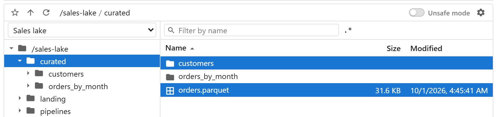

### Filter

Type in the field above the list to show names containing the text, or matching a regular expression with **.\***.
✕ or Esc clears; opening another folder clears it too.

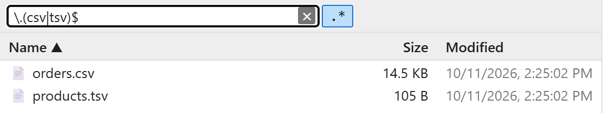

### View files

Select a file and click **Preview** at the bottom right of the list (with nothing selected: the folder shown, e.g. a
Delta Lake table), or double-click a file JupyterLab cannot open, e.g. Parquet. The preview panel opens below the list;
tables open in the [data browser](#data-browser-and-view-tabs). Right-click → **View** *format* **in new tab** opens it in
a JupyterLab tab of its own. **Close preview** or Esc closes the panel.

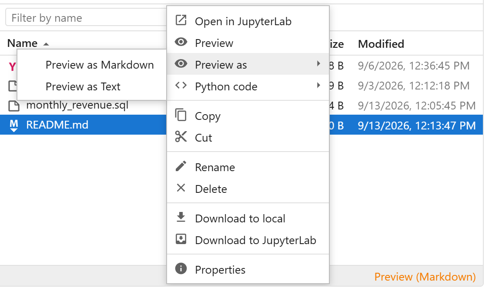

### Edit files

Double-click a file, or right-click → **Edit**, to open it in JupyterLab's editor; **Save** writes it back to the
storage. Needs the [launcher](../launcher/README.md) package.

### Switch engine

Previews read data with an [engine](#engines), shown left of **Preview**: Polars, pandas or PySpark, each when
installed. Click it to choose another; the preview open is shown again with it, and the choice is remembered.

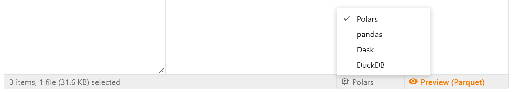

### Right-click

- **View** *format* **in new tab**, **Preview** *format*: with the [engine](#engines) chosen
- **View in new tab as**, **Preview as**: with another format or engine
- **Python code**: code loading the data, for each engine
- **Copy**, **Cut**, **Copy URL**, **Copy path** (local disk), **Paste**
- **Edit**, **Rename**, **Create a folder**, **Delete**
- **Download to local**, **Download to JupyterLab**
- **Properties**, **Add bookmark**

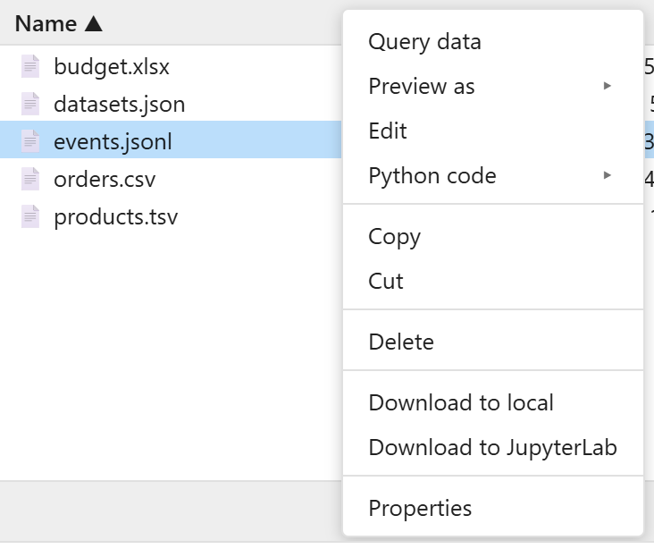

### Properties

A file's size, modification time and everything its storage tells about it; for folders and several items, the number
of files and folders, their total size, and the oldest and newest files.

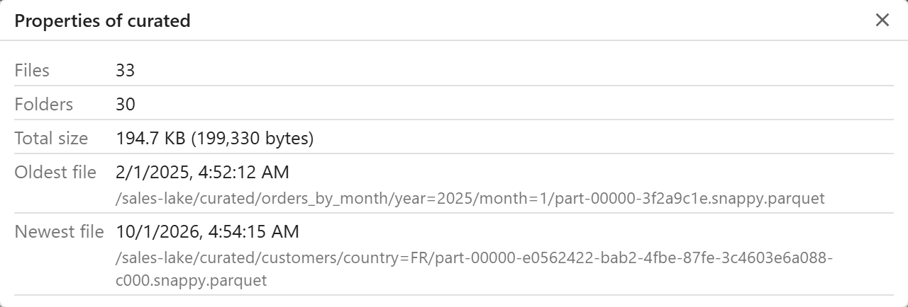

### Bookmarks

Right-click a folder → **Add bookmark**. ☆ lists them; click one to open it, right-click it for Copy URL (Copy path
for a local folder) and Delete bookmark.

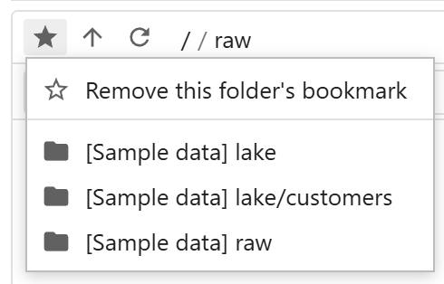

### Copy, cut and paste

Between storages and between explorers, also in other notebooks.

### Keyboard shortcuts

Click the list, then use the keys its right-click menu shows (⌘ instead of Ctrl on macOS):

| Key            | Does                                                         |
|----------------|--------------------------------------------------------------|
| Ctrl+C, Ctrl+X | Copy, cut the selected items                                 |
| Ctrl+V         | Paste into the folder shown                                  |
| F2             | Rename the selected item                                     |
| Delete         | Delete the selected items (⌘⌫ on macOS)                      |
| Enter          | Open the selected item, as a double-click                    |

Folders still need [Unsafe mode](#unsafe-operations).

### Drag and drop

Drop files from JupyterLab's file browser or your computer to upload them; drag files onto a folder to move them, onto
another explorer of the same JupyterLab page (another tab or notebook) to copy them there, as Paste does, or onto
JupyterLab's file browser to download them (needs [the launcher](../launcher/README.md)). Drags from other browser tabs
or windows are refused.

### Background operations

Moving, renaming, deleting, pasting and downloading to JupyterLab run in the background, with progress and **Cancel** above the
status bar.

## Unsafe operations

Folder operations need **Unsafe mode**, turned on with the slider at the right of the toolbar, for one operation:

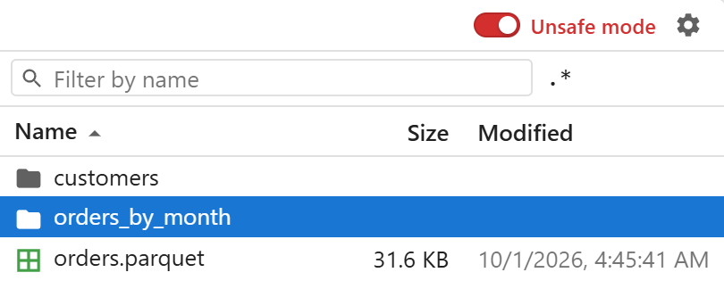

| Operation              | How                                                                                          |
|------------------------|----------------------------------------------------------------------------------------------|
| Move folders           | Drag a folder onto another folder, or right-click → **Cut**, then **Move here** on a folder. |
| Copy and paste folders | Right-click → **Copy**, then **Paste** on a folder.                                          |
| Rename folders         | Right-click → **Rename** (on most storages, a move of everything in it).                     |
| Delete folders         | Right-click → **Delete** (with everything in it).                                            |

## File transfer between file systems

Files are moved and copied within a storage by the storage itself where it can (a rename, a copy on the server); between
storages, the kernel copies them file by file, through a temporary file:

- A failed or cancelled copy leaves no partial file, and a move deletes each file only once its copy is complete.

When files are copied or dragged from one explorer to another, **the destination explorer reads them with a file
system of its own** for the source storage. If it has none for that storage, e.g. one in another kernel's memory or on another
machine's disk, the transfer is refused. Storages of kinds other than Azure, S3, Google Cloud Storage, SFTP, local disks
and in-memory ones are looked for only among the destination explorer's own storages.

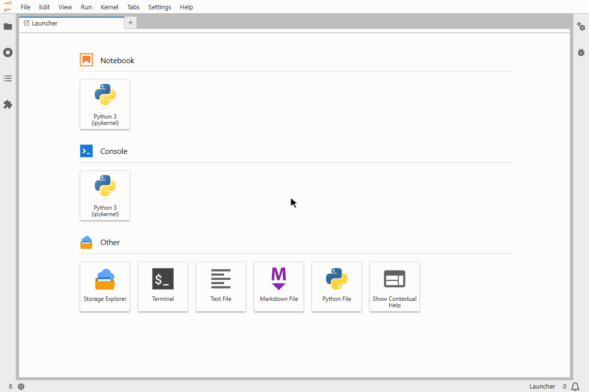

For example, with a MinIO storage, `s3fs` with `endpoint_url="http://minio:9000"`, in the source explorer:

- If the destination explorer, in another notebook, has a storage of that endpoint, files dragged onto it are read
  with that storage.
- If not, but fsspec's configuration sets that endpoint for S3, they are read with the S3 storage fsspec opens.
- Otherwise they are refused.

## Large files

Files sent between your computer and the explorer go through the kernel's connection with the page, so they are
limited:

| Transfer                                        | Limit                                       |
|-------------------------------------------------|---------------------------------------------|
| Upload from your computer (drop a file)         | 10 MB per file (`max_upload_bytes`)         |
| **Download to local**                           | 100 MB                                      |
| Between storages (paste, drag to an explorer)   | None: the kernel copies them, in the background |
| From or to JupyterLab's file browser (drag, **Download to JupyterLab**) | None: the kernel copies them on the server's disk |

For larger files, put them on a storage the kernel reaches (e.g. JupyterLab's file browser, by its own upload) and
copy them from there, or download them to JupyterLab, then from its file browser.

## Transfer policy

`transfer_policy=[...]` limits where files may be copied or moved: within a storage (moves onto a folder, renames, copy
or cut and paste), between storages, to or from JupyterLab's file browser, and to or from your computer. The first rule
whose `src` and `dest` regular expressions match the whole URLs decides; without one, files go:

```python
StorageExplorer(filesystems={...}, transfer_policy=[
    {"rule": "allow", "src": r"abfs://lake@acct\.dfs\.core\.windows\.net/public/.*", "dest": ".*"},
    {"rule": "allow", "src": r"abfs://lake@.*", "dest": r"abfs://lake@.*"},  # within the lake
    {"rule": "deny", "src": r"abfs://lake@.*", "dest": ".*"},  # nothing else leaves the lake
])
```

URLs are those of "Copy URL" (`file:///...` for local files); files through JupyterLab's file browser are `jupyterlab://<absolute path>`, e.g.
`jupyterlab:///home/jovyan/x.csv`, and files on your computer `browser:///<name>`. A pattern left out matches any URL.
A folder is checked as one item, by its own URL. It prevents mistakes; it is not a security boundary. For the launcher's
tabs, use `transfer_policy()` in [its configuration](../launcher/README.md#configuration).

**Named groups** tie the two URLs together: `(?P<name>...)` in both patterns, and the rule matches only if each group
captures the same text in both. Both patterns must have the same group names. With `L` for
`acct\.dfs\.core\.windows\.net`:

| Files may move or be copied            | `src` and `dest` (an `allow` rule, before a broader `deny`)                                  |
|----------------------------------------|-----------------------------------------------------------------------------------------------|
| Within each container                  | `abfs://(?P<container>[^@/]+)@L/.*` in both                                                   |
| Within each project folder of `raw`    | `abfs://raw@L/(?P<project>[^/]+)/.*` in both                                                  |
| From `raw` to `curated`, same project  | `abfs://raw@L/(?P<project>[^/]+)/.*` → `abfs://curated@L/(?P<project>[^/]+)/.*`              |
| Within each user's folder              | `abfs://home@L/(?P<user>[^/]+)/.*` in both                                                    |

The `deny` after it has no groups, e.g. `{"rule": "deny", "src": r"abfs://[^@/]+@L/.*"}` for "not between containers".

## Data browser and view tabs

Tables open in the data browser: page, sort, filter and choose columns, on the data itself (**Live**) or on its first
100,000 rows (**In memory**); see [Using the data browser](data-explorer.md#using-the-data-browser). With the
[launcher](../launcher/README.md), **View in new tab** opens a view in a JupyterLab tab of its own, e.g. to compare
tables side by side.

### Engines

The engine is the library previews read data with: **Polars**, **pandas** or **PySpark**, each with its
[plugin](#plugins). Engines read storage with their
own settings, e.g. the environment's credential setup (an AWS profile, an Azure CLI login), not the explorer's: see
[Format options](#format-options). Text,
Markdown, JSON and images are shown by the explorer itself. When the engine chosen cannot view an item, use **Preview
as**.

`engine_preference` orders the engines offered; the first is chosen until the user chooses another:

```python
StorageExplorer("s3://my-bucket/lake", engine_preference=["pandas", "polars"])
```

### Reading pages

`fetch_rows=` customizes how live queries read each page of rows. Tables can be read by different libraries, so check
the library of the data, handle those you want to, and return `None` for the others to read them the default way:

```python
import narwhals as nw


def streaming_pages(lf, offset, length):
    if lf.implementation.is_polars():
        page = lf.to_native().slice(offset, length).collect(engine="streaming")
        return nw.from_native(page)
    return None  # other libraries: the default


StorageExplorer("s3://my-bucket/lake", fetch_rows=streaming_pages)
```

## Remembered states

Bookmarks, the data browser's settings and the engine chosen are shared by the explorers in the kernel. To keep them in a file, shared
with other kernels and [the launcher](../launcher/README.md)'s tabs, give its path, or an `ExplorerStates` for other
options:

```python
from jupyter_storage_explorer import ExplorerStates, StorageExplorer

StorageExplorer("s3://my-bucket/data", states="~/.jupyter/storage-explorer/states.json")  # the launcher's file
StorageExplorer("s3://my-bucket/data", states=ExplorerStates("states.json", max_queries=50))
```

## Supported formats

| Format                                                       | Name         | Preview                       | Data browser | Load with                                           |
|--------------------------------------------------------------|--------------|-------------------------------|--------------|-----------------------------------------------------|
| Delta Lake tables                                            | `delta`      | First rows                    | ✓            | polars (with deltalake), PySpark (with delta-spark) |
| Parquet files, and folders of them (e.g. Spark, Hive output) | `parquet`    | First rows                    | ✓            | polars, pandas, PySpark                             |
| CSV, TSV                                                     | `csv`        | First rows                    | ✓            | polars, pandas, PySpark                             |
| JSON Lines                                                   | `json-lines` | First records                 | ✓            | polars, pandas, PySpark                             |
| JSON                                                         | `json`       | Collapsible tree              |              | Python, polars, pandas                              |
| Excel (`.xlsx`)                                              | `excel`      | Its sheets, on tabs           | ✓            | polars, pandas                                      |
| Markdown                                                     | `markdown`   | Rendered                      |              | Python                                              |
| Text, code, configuration (YAML, SQL, Python, …)             | `text`       | With syntax highlighting      |              | Python                                              |
| Images (PNG, JPEG, GIF, SVG, …)                              | `image`      | Shown                         |              | Python (Pillow)                                     |

Folders of Parquet files written by Spark or Hive, partitioned or not, are supported; folders written by other tools
may work, but are not guaranteed to.

Each format's view (the preview, the data browser) is the [engine](#engines) chosen's, and its code is shown for
every engine in **Python code**, each recipe with its engine (a support given for an engine replaces the default one's).
The name identifies the format in CSS (see [Icons](../DEVELOPMENT.md#icons)) and in [Format options](#format-options).
To handle a format with another library, see [Format supports](development-plugin.md#format-supports).

## Format options

`format_options` gives the engines' options, by engine key (`"python"` for the explorer's own views and code), then
format name, or `"*"` for all formats (a format's options override those for all):

```python
StorageExplorer(
    "s3://my-bucket/lake",
    format_options={
        "polars": {
            "*": {"storage_options": {"aws_region": "eu-west-1"}},
            "delta": {"use_pyarrow": True},
        },
        "pandas": {"*": {"storage_options": {"anon": False}}},
    },
)
```

| Library   | Options                                                                     | Formats                                                  | Meaning                                                                                      |
|-----------|-----------------------------------------------------------------------------|----------------------------------------------------------|----------------------------------------------------------------------------------------------|
| `polars`  | each format's reader's arguments (e.g. `scan_csv`'s), and `storage_options`  | `delta`, `parquet`, `csv`, `json-lines`, `json`, `excel` | See polars-support's [Format options](../plugins/polars-support/README.md#format-options).   |
| `pandas`  | each format's reader's arguments (e.g. `read_csv`'s), and `storage_options`  | `parquet`, `csv`, `json-lines`, `json`, `excel`          | See pandas-support's [Format options](../plugins/pandas-support/README.md#format-options).   |
| `pyspark` | the session's and each format's reader options                             | `delta`, `parquet`, `csv`, `json-lines`                  | See pyspark-support's [Format options](../plugins/pyspark-support/README.md#format-options). |
| `python`  | `storage_options`                                                           | `json`, `text` (also Markdown's code), `image`           | `fsspec.open`'s keyword arguments, in the code.                                              |

Options that look like credentials are left out of the code. A library, format or option name that no support takes is
an error.

Options that depend on where the data is, e.g. one key per Azure storage account, are given by a function of the item's
location instead of a dict. It is called each time a file is viewed or its code shown:

```python
keys = {"sales": "...", "finance": "..."}

StorageExplorer(
    filesystems={"Sales": "abfs://lake@sales.dfs.core.windows.net", "Finance": "abfs://lake@finance.dfs.core.windows.net"},
    format_options={
        "polars": {"*": lambda location: {"storage_options": {"account_key": keys[location.account_name]}}},
    },
)
```

The location's fields depend on the storage, e.g. `account_name` on Azure, `bucket` on S3.

## Working with the explorer from Python

```python
explorer = StorageExplorer("s3://my-bucket/data")
explorer
```

```python
explorer.folder_url  # the URL of the folder shown, e.g. to pass to polars or pandas
explorer.selected_urls  # the URLs of the selected items
explorer.folder_location  # where the folder shown is: its .url, and a local folder's .path
explorer.selected_locations  # the same for the selected items
explorer.query_result()  # the table in the data browser, with its filters; None if none
explorer.query_table  # of an item of several tables (a database, a workbook...): the one chosen
```

`on_change(f)` calls `f(explorer)` when the folder shown or the selection changes, and `on_query_change(f)` when
`query_result()` does: another table opened in the preview panel (or none), also another of an item's several tables,
other filters, sort or columns, or the data read again. The functions run as the kernel handles the widget's messages, so what they print goes to no cell: display
into an `ipywidgets.Output`. Keep them quick: the widget waits for them. `remove=True` stops calling one.

For example, a chart of the CSV file you click, which follows the filters you set in the data browser. Some CSV files
in a cloud storage first:

```python
import datetime as dt
import random

import fsspec
import polars as pl

folder = "s3://my-bucket/demo/sales"  # any storage you can write to
days = pl.date_range(dt.date(2026, 1, 1), dt.date(2026, 6, 30), eager=True)
for region in ["north", "south", "east", "west"]:
    sales = pl.DataFrame(
        {
            "date": days,
            "channel": random.choices(["online", "retail", "wholesale"], k=len(days)),
            "amount": [random.randint(50, 500) for _ in days],
        }
    )
    with fsspec.open(f"{folder}/{region}.csv", "w") as f:
        sales.write_csv(f)
```

An explorer of them, its preview panel open, so that clicking a file opens it in the data browser:

```python
from jupyter_storage_explorer import StorageExplorer

explorer = StorageExplorer(folder, preview_panel="open")
explorer
```

And the chart, in a cell of its own:

```python
import ipywidgets
import matplotlib.pyplot as plt

chart = ipywidgets.Output()


def draw(explorer):
    with chart:
        chart.clear_output(wait=True)
        result = explorer.query_result()
        if result is None:
            return  # no table in the preview panel
        daily = result.group_by("date").agg(pl.col("amount").sum()).sort("date").collect()
        plt.figure(figsize=(8, 3))
        plt.plot(daily["date"], daily["amount"])
        plt.show()


explorer.on_query_change(draw)
chart
```

Filter by channel in the data browser, and the chart shows that channel's sales. Without the data browser,
`on_change` and `selected_urls` give the files themselves, e.g. `pl.read_csv(url)` for each one selected.

## StorageExplorer options

Storages and data:

| Option                    | Meaning                                                                                                    |
|---------------------------|------------------------------------------------------------------------------------------------------------|
| `filesystems={...}`       | Several named storages; see [Several storages in one explorer](#several-storages-in-one-explorer).         |
| `plugin_options={...}`    | The plugins' options, by key, e.g. `{"pandas-support": {"enabled": False}}`; see [Plugins](#plugins). |
| `format_options={...}`    | The engines' options; see [Format options](#format-options).                                               |
| `engine_preference=[...]` | The engines in the order they are offered, the first chosen until the user chooses; see [Engines](#engines). |

Views:

| Option                        | Meaning                                                                                                                               |
|-------------------------------|---------------------------------------------------------------------------------------------------------------------------------------|
| `height="400px"`              | Height of the tree and list; the preview panel adds its own space below. `"fill"`: as tall as the container, e.g. the launcher's tab. |
| `tree_view="open"`            | The folder tree: `"open"`, `"closed"` (its button in the toolbar shows it) or `"disabled"` (no tree).                                |
| `preview_panel="closed"`      | The preview panel: `"open"` starts with it open, so that clicking a file previews it; `"disabled"`: none, items open in new tabs (**View** in place of Preview). |
| `layout="standard"`           | `"sidebar"`: a narrow layout, as in the launcher's side panel: Unsafe mode in the ⚙ menu, Up and the path on a bar of their own, the list with Size only by default, the pager below it. |
| `view_limits=ViewLimits(...)` | How much views read and show (`formats.ViewLimits`): `max_bytes`, `max_display_rows` (also the data browser's page size), `max_whole_file_bytes`, `max_live_rows`, `max_memory_rows`. |
| `max_browser_items=20_000`    | Folders with more items are filtered, sorted and paged by the kernel, one page at a time, instead of the browser (`None`: never).     |
| `fetch_rows=...`              | How the data browser reads pages; see [Reading pages](#reading-pages).                                                                |

Downloads and states:

| Option                              | Meaning                                                                                                                               |
|-------------------------------------|---------------------------------------------------------------------------------------------------------------------------------------|
| `download_to_jupyterlab_path="."`   | Folder "Download to JupyterLab" copies into, e.g. `"~/Downloads"`; default: where it runs.                                            |
| `max_upload_bytes=10 * 1024 * 1024` | Largest file you can upload from your computer (default 10 MB; `None` for no limit).                                                  |
| `states="states.json"`              | Where bookmarks, the data browser's settings and the engine chosen are kept (a path or an `ExplorerStates`); see [Remembered states](#remembered-states). |

Transfers:

| Option                  | Meaning                                                                         |
|-------------------------|---------------------------------------------------------------------------------|
| `transfer_policy=[...]` | Where files may be copied or moved; see [Transfer policy](#transfer-policy).    |

For extending the explorer (see [Extensions](#extensions)), tried before the defaults:

| Option                     | Meaning                                                                                                               |
|----------------------------|-----------------------------------------------------------------------------------------------------------------------|
| `operations=[...]`         | File operations; see [File operations](development-plugin.md#file-operations).                                     |
| `supports=[...]`           | Formats and the libraries handling them; see [Format supports](development-plugin.md#format-supports).            |
| `filesystem_mappers=[...]` | How storages are told apart; see [Filesystem mappers](development-plugin.md#filesystem-mappers).                   |

## Extensions

### Plugins

Plugins add engines and storages. Explorers use every plugin installed; `plugin_options` gives their options by key:
`enabled` (False: not used), `priority` (higher first) and the plugin's own (in the launcher's tabs,
`plugin_options()` in [its configuration](../launcher/README.md#configuration)):

```python
StorageExplorer(
    "abfs://lake@myaccount.dfs.core.windows.net/raw",
    plugin_options={"pandas-support": {"enabled": False}, "abfs-support": {"concurrency": 16}},
)
```

| Plugin            | Adds                                                                                          | Install                                          |
|-------------------|-----------------------------------------------------------------------------------------------|--------------------------------------------------|
| [`polars-support`](../plugins/polars-support/README.md)  | Polars: Delta Lake, Parquet, CSV, JSON Lines, Excel                                           | `pip install "jupyter-storage-explorer[polars]"`  |
| [`pandas-support`](../plugins/pandas-support/README.md)  | pandas: Parquet, CSV, JSON Lines, Excel                                                       | `pip install "jupyter-storage-explorer[pandas]"`  |
| [`pyspark-support`](../plugins/pyspark-support/README.md) | PySpark or Databricks Connect: Delta Lake, Parquet, CSV, JSON Lines                           | `pip install "jupyter-storage-explorer[pyspark]"` |
| [`abfs-support`](../plugins/abfs-support/README.md)    | Azure Data Lake Storage Gen2: folders moved in one step, copies within an account on the server (`concurrency`, default 64, at once), empty folders | `pip install "jupyter-storage-explorer[abfs]"`    |

Each plugin's README has its options (`plugin_options`, and `format_options` for its engine).

`[all]` installs every plugin with its libraries. `[<name>-support]` (`[all-supports]` for every plugin) installs a plugin alone, using the libraries already installed: plugins never install or upgrade
them otherwise, so that a shared environment's stay as its administrators set them up.

⚙ at the right of the toolbar → **About** shows the explorer's version and the plugins installed, those not used greyed
out; hover over ⓘ for a plugin's description.

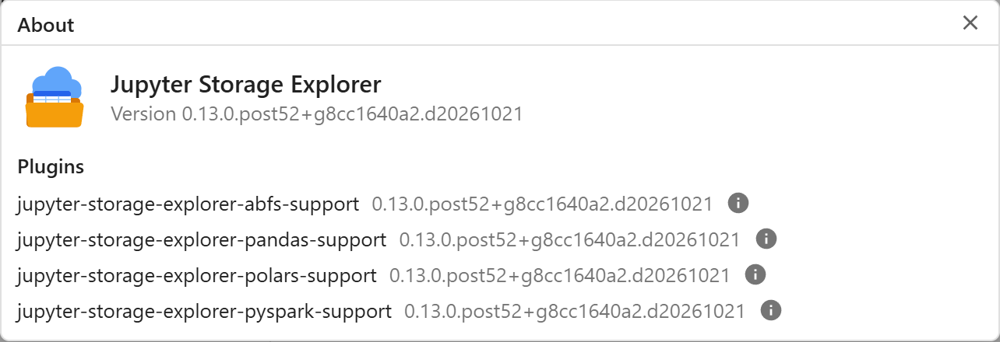

### Writing your own

Plugins, and formats, file operations or storages given to one explorer (`supports`, `operations`,
`filesystem_mappers`): see [development-plugin.md](development-plugin.md).
