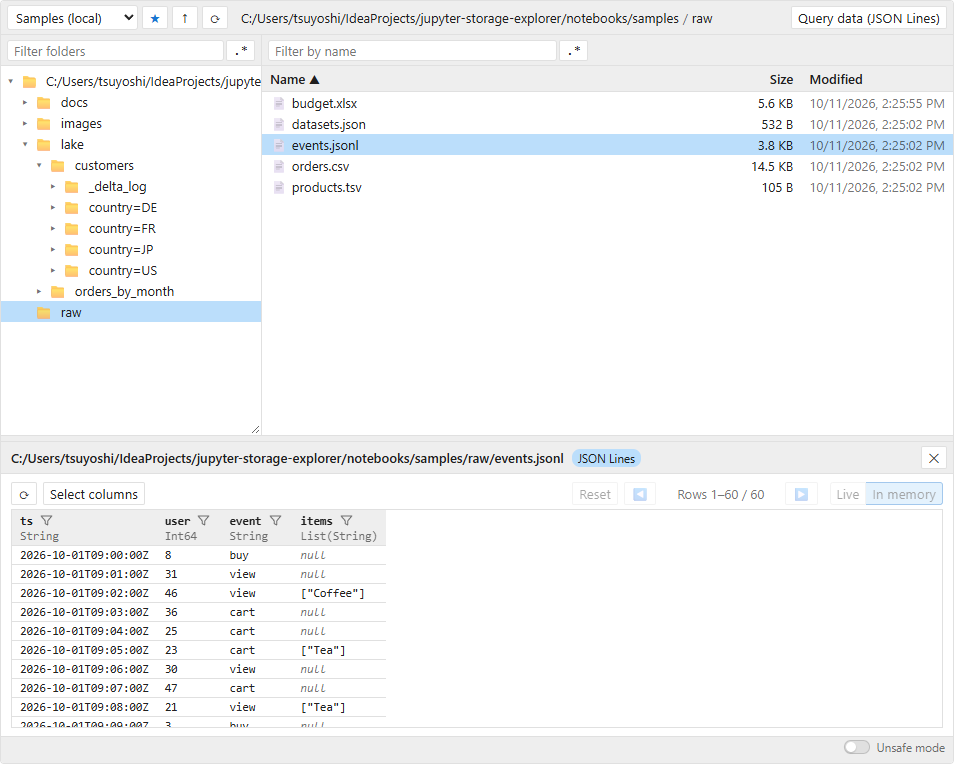

# StorageExplorer

`StorageExplorer` is the file explorer: browse storage, preview files, query tables, and upload, download, move and
edit files. For installation and a first example, see the [README](../README.md).



- [Storages](#storages)
- [Using the explorer](#using-the-explorer)
- [Unsafe operations](#unsafe-operations)
- [Transfer policy](#transfer-policy)
- [Query data](#query-data)
- [Remembered states](#remembered-states)
- [Supported formats](#supported-formats)
- [Format options](#format-options)
- [Working with the explorer from Python](#working-with-the-explorer-from-python)
- [StorageExplorer options](#storageexplorer-options)

## Storages

The first argument is the address of the folder to open; options after it are passed to the storage package, for
example to choose credentials:

```python
from jupyter_storage_explorer import StorageExplorer

StorageExplorer()  # the current folder
StorageExplorer("abfs://lake@myaccount.dfs.core.windows.net/raw")  # Azure Data Lake
StorageExplorer("s3://my-bucket/data", profile="analytics")  # Amazon S3, with options
StorageExplorer("gs://my-bucket", token="google_default")  # Google Cloud
```

| Storage                        | Package    | Address                                              |
|--------------------------------|------------|------------------------------------------------------|
| Amazon S3                      | `s3fs`     | `s3://bucket/path`                                   |
| Azure Data Lake / Blob Storage | `adlfs`    | `abfs://container@account.dfs.core.windows.net/path` |
| Google Cloud Storage           | `gcsfs`    | `gs://bucket/path`                                   |
| Local disk, in-memory          | (included) | `/path`, `memory://`                                 |

### Several storages in one explorer

Give each storage a name; a drop-down on the left of the address bar switches between them, and each one remembers the
folder you were in.

```python
StorageExplorer(
    filesystems={
        "Data lake": "abfs://lake@myaccount.dfs.core.windows.net",
        "Raw files (S3)": "s3://my-bucket/raw",
        "Local": "/home/me/data",
    },
)
```

### Azure Data Lake Storage Gen2

On accounts with a hierarchical namespace, `pip install "jupyter-storage-explorer[abfs]"` and
`operations=[AzureDataLakeGen2Operation(), *StorageExplorer.default_operations()]` (from
`jupyter_storage_explorer.filesystems.abfs`) move folders in one step and create empty folders.

## Using the explorer

- **Browse**: click folders in the tree or list; ↑ goes up, ⟳ refreshes. Ctrl+click (⌘+click) selects several items.
  The list shows 100 items per page (◀ ▶ above it).
- **Filter**: type in the fields above the tree and the list (and in **Select columns** of the data browser) to show
  only names containing the text, or matching a regular expression with **.\***. Case is ignored; ✕ or Esc clears.
- **Preview**: double-click a file, or **Preview** (with nothing selected: the current folder, e.g. a Delta Lake table).
  Tables open in the [data browser](#query-data).
- **Right-click**: Preview as, Edit, Python code to load the data, Copy, Cut, Paste, Delete, Create a folder, Download
  to local or to JupyterLab, Copy URL, Add bookmark.
- **Bookmarks**: ☆ (★ when the folder shown is bookmarked) lists them; click one to open it, right-click it for Copy
  URL and Delete bookmark. Explorers in the kernel share them (see [Remembered states](#remembered-states)).
- **Copy, cut and paste** work between storages and between explorers, also in other notebooks: **Cut**, then
  **Move here**, moves files to another storage.
- **Drag and drop**: drop files from JupyterLab's file browser or your computer to upload them; drag files onto a folder
  to move them, or onto JupyterLab's file browser to download them (needs [the launcher](../launcher/README.md)).
- **In the background**: moving, deleting, pasting and downloading to JupyterLab run while you keep browsing, with
  their progress above the status bar and **Cancel**. The list follows as they go.

## Unsafe operations

Folder operations need **Unsafe mode**, turned on with the slider in the status bar:

| Operation              | How                                                                                          |
|------------------------|----------------------------------------------------------------------------------------------|
| Move folders           | Drag a folder onto another folder, or right-click → **Cut**, then **Move here** on a folder. |
| Copy and paste folders | Right-click → **Copy**, then **Paste** on a folder.                                          |
| Delete folders         | Right-click → **Delete** (with everything in it).                                            |

## Transfer policy

`transfer_policy=[...]` limits the directions files may be transferred in: copied or moved from one storage to another
(copy or cut, then paste), to or from JupyterLab's file browser, and uploaded from or downloaded to your computer.
Moving and copying within a storage (e.g. dragging files onto a folder) is not a transfer. It is a list of rules,
tried in order; the first whose `src` and `dest` regular expressions both match the whole URLs decides, and without
one, files go:

```python
StorageExplorer(filesystems={...}, transfer_policy=[
    {"rule": "allow", "src": r"abfs://lake@acct\.dfs\.core\.windows\.net/public/.*", "dest": ".*"},
    {"rule": "deny", "src": r"abfs://lake@.*", "dest": ".*"},  # nothing else leaves the lake
])
```

URLs are those of "Copy URL" (local files: their path; the destination: the item's new location). Files on the
Jupyter server through JupyterLab's file browser ("Download to JupyterLab", drag and drop with it) are
`jupyterlab://<absolute path>`, e.g. `jupyterlab:///home/jovyan/x.csv`, and files on your computer
`browser:///<name>`. A pattern left out matches any URL. Items refused are reported, the others done.
This keeps files from going the wrong way by mistake; it is not a security boundary.

## Query data

With [polars](https://pola.rs) installed (plus `deltalake` for Delta Lake, `fastexcel` for Excel), tables open in a data
browser that reads 1,000 rows at a time: page, sort, filter and choose columns, on the data itself (**Live**) or on its
first 100,000 rows read into memory (**In memory**). It is the same browser as `DataExplorer`'s; see
[Using the data browser](data-explorer.md#using-the-data-browser).

Filters, sorting, hidden columns, widths and the mode chosen are remembered for the 20 tables queried last (see
[Remembered states](#remembered-states)). polars reads the data with the credentials in the environment, not the
explorer's options; see [Format options](#format-options) for its own.

## Remembered states

Bookmarks and the data browser's settings are kept in an `ExplorerStates`, shared by the explorers in the kernel, until
it restarts. To keep them in a JSON file, also shared with other kernels (read again when an explorer is created and
before each change), give its path, or an `ExplorerStates` for other options:

```python
from jupyter_storage_explorer import ExplorerStates, StorageExplorer

StorageExplorer("s3://my-bucket/data", states="~/.jupyter/storage-explorer/states.json")
StorageExplorer("s3://my-bucket/data", states=ExplorerStates("states.json", max_queries=50))
```

Explorers in [the launcher](../launcher/README.md)'s tabs use `~/.jupyter/storage-explorer/states.json`, so the first
example shares their bookmarks.

A bookmark names a storage of the explorer (its name in `filesystems`, or `"default"`) and a folder; explorers list
those of their own storages.

## Supported formats

| Format                                                       | Name         | Preview                       | Query data | Load with                                           |
|--------------------------------------------------------------|--------------|-------------------------------|------------|-----------------------------------------------------|
| Delta Lake tables                                            | `delta`      | First rows                    | ✓          | polars (with deltalake), PySpark (with delta-spark) |
| Parquet files, and folders of them (e.g. Spark, Hive output) | `parquet`    | First rows                    | ✓          | polars, pandas, PySpark                             |
| CSV, TSV                                                     | `csv`        | First rows                    | ✓          | polars, pandas, PySpark                             |
| JSON Lines                                                   | `json-lines` | First records                 | ✓          | polars, pandas, PySpark                             |
| JSON                                                         | `json`       | Collapsible tree              |            | Python, polars, pandas                              |
| Excel (`.xlsx`)                                              | `excel`      | First rows of the first sheet | ✓          | polars, pandas                                      |
| Markdown                                                     | `markdown`   | Rendered                      |            | Python                                              |
| Text, code, configuration (YAML, SQL, Python, …)             | `text`       | With syntax highlighting      |            | Python                                              |
| Images (PNG, JPEG, GIF, SVG, …)                              | `image`      | Shown                         |            | Pillow                                              |

Previewing and querying data files needs a data library, e.g. `pip install polars deltalake`. If one is missing, the
preview tells you what to install. The name identifies the format in CSS (see
[Customizing icons](../DEVELOPMENT.md#customizing-icons)).

## Format options

`format_options` is one dictionary for all formats; each format uses the options it takes. Options are named after the
library they are for, and the ones for a single format also after the format:

```python
StorageExplorer(
    "s3://my-bucket/lake",
    format_options={
        "polars_storage_options": {"aws_region": "eu-west-1"},
        "pandas_storage_options": {"anon": False},
        "polars_delta_use_pyarrow": True,
    },
)
```

| Option                         | Formats                                         | Meaning                                                                                                               |
|--------------------------------|-------------------------------------------------|-----------------------------------------------------------------------------------------------------------------------|
| `polars_storage_options`       | `delta`, `parquet`, `csv`, `json-lines`         | polars' `storage_options` (object_store's names, not fsspec's), in the preview, the data browser and the polars code. |
| `polars_credential_provider`   | `delta`, `parquet`, `csv`, `json-lines`         | polars' `credential_provider`, in the preview and the data browser (not in the code).                                 |
| `pandas_storage_options`       | `parquet`, `csv`, `json-lines`, `json`, `excel` | pandas' `storage_options` (fsspec's), in the pandas code.                                                             |
| `fsspec_storage_options`       | `json`, `excel`, `markdown`, `text`, `image`    | `fsspec.open`'s keyword arguments, in the code that reads with fsspec.                                                |
| `polars_delta_table_options`   | `delta`                                         | `scan_delta`'s `delta_table_options`.                                                                                 |
| `polars_delta_use_pyarrow`     | `delta`                                         | `scan_delta`'s `use_pyarrow`.                                                                                         |
| `polars_delta_pyarrow_options` | `delta`                                         | `scan_delta`'s `pyarrow_options`.                                                                                     |

Storage options that look like credentials are left out of the code. Without storage options, the code relies on the
environment's configuration and credentials.

## Working with the explorer from Python

```python
explorer = StorageExplorer("s3://my-bucket/data")
explorer
```

```python
explorer.folder_url  # the URL of the folder shown, e.g. to pass to polars or pandas
explorer.selected_urls  # the URLs of the selected items
```

## StorageExplorer options

| Option                              | Meaning                                                                                                                               |
|-------------------------------------|---------------------------------------------------------------------------------------------------------------------------------------|
| `height="400px"`                    | Height of the tree and list; the preview panel adds its own space below. `"fill"`: as tall as the container, e.g. the launcher's tab. |
| `max_upload_bytes=10 * 1024 * 1024` | Largest file you can upload from your computer (default 10 MB; `None` for no limit).                                                  |
| `download_to_jupyterlab_path="."`   | Folder "Download to JupyterLab" copies into, e.g. `"~/Downloads"`; default: where it runs. To refuse downloads, use `transfer_policy`. |
| `filesystems={...}`                 | Several named storages; see [Several storages in one explorer](#several-storages-in-one-explorer).                                    |
| `max_browser_items=20_000`          | Folders with more items are filtered, sorted and paged by the kernel, one page at a time, instead of the browser (`None`: never).     |
| `operations=[...]`                  | How files are moved, copied, deleted and downloaded, replacing `StorageExplorer.default_operations()`: e.g. `[MyOps(), *StorageExplorer.default_operations()]` for server-side copies of your own (see [operations.py](../src/jupyter_storage_explorer/operations.py), and [filesystems](../src/jupyter_storage_explorer/filesystems) for the defaults). |
| `transfer_policy=[...]`             | Rules for transfers of files between storages; see [Transfer policy](#transfer-policy).                                               |
| `states="states.json"`              | Where bookmarks and the data browser's settings are kept (a path or an `ExplorerStates`); see [Remembered states](#remembered-states). |
| `format_options={...}`              | Options for the formats (see [Format options](#format-options)).                                                                      |
